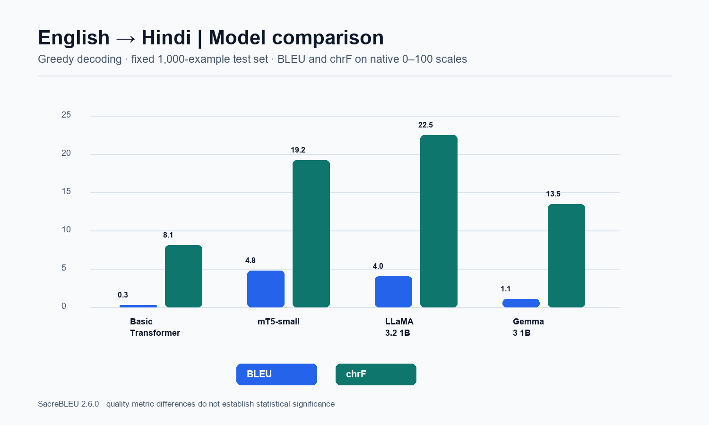

# English-to-Hindi Machine Translation with Generative Models

Comparative machine-translation experiments for Foundations of Generative AI (ICT4403), Assignment 3. The project evaluates a randomly initialized encoder-decoder Transformer, fine-tuned mT5-small, and prompted LLaMA 3.2 1B and Gemma 3 1B systems on OPUS-100 English-Hindi.

## Results at a glance

The submitted run covers 1,000 held-out examples. At temperature 0, **mT5-small has the highest BLEU (4.80)** and **LLaMA 3.2 1B has the highest chrF (22.52)**. There is no single winner across both metrics. All four absolute scores are low, so these results indicate substantial remaining translation errors and should not be presented as production-quality translation.

| System | Architecture / adaptation | BLEU | chrF | Train time | Inference (s/example) | Parameters |
| --- | --- | ---: | ---: | ---: | ---: | ---: |
| Basic Transformer | Encoder-decoder; trained from scratch | 0.30 | 8.12 | 7.2 min | 0.061 | 7.4M |
| mT5-small | Encoder-decoder; fine-tuned | **4.80** | 19.21 | 46.9 min | 0.136 | 300.2M |
| LLaMA 3.2 1B Instruct | Decoder-only; prompted | 4.03 | **22.52** | Not fine-tuned | 1.368 | 1,235.8M |
| Gemma 3 1B IT | Decoder-only; prompted | 1.09 | 13.48 | Not fine-tuned | 1.525 | 999.9M |

The encoder-decoder models were evaluated with batch size 32 and up to 256 new tokens; the decoder-only models used batch size 8 and up to 128 new tokens. Runtime comparisons are therefore indicative, not perfectly controlled. Detailed measurements, sampling-temperature results, training metrics, and per-example predictions are in [`results/2026-11-en-hi/`](results/2026-11-en-hi/).

See the [detailed results and responsible-use analysis](docs/RESULTS_AND_ANALYSIS.md) for exact settings, metric tables, a translation example, and limitations.

### Figures



Individual model charts: [Basic Transformer](results/2026-11-en-hi/figures/basic_transformer_results.png) · [mT5-small](results/2026-11-en-hi/figures/mt5-small_results.png) · [LLaMA 3.2 1B](results/2026-11-en-hi/figures/llama_32_1b_results.png) · [Gemma 3 1B](results/2026-11-en-hi/figures/gemma_3_1b_results.png)

Temperature charts: [LLaMA](results/2026-11-en-hi/figures/llama_32_1b_temperature.png) · [Gemma](results/2026-11-en-hi/figures/gemma_3_1b_temperature.png)

## Assignment objective and approach

The objective is to compare encoder-decoder and decoder-only translation systems on a shared English-to-Hindi test set, measuring BLEU, chrF, training or fine-tuning time, inference time, and parameter count. The assignment also asks for analysis of temperature and responsible-use risks.

| Model | Model family | Method |
| --- | --- | --- |
| Basic Transformer | Encoder-decoder | Randomly initialized model with ByT5 tokenizer; trained for 3 epochs |
| mT5-small | Encoder-decoder | `google/mt5-small`; fine-tuned for 3 epochs |
| LLaMA 3.2 1B Instruct | Decoder-only | Zero-shot instruction prompting; no fine-tuning |
| Gemma 3 1B IT | Decoder-only | Zero-shot instruction prompting; no fine-tuning |

The submitted notebook describes a seeded subset of 20,000 training, 1,000 validation, and 1,000 test examples from OPUS-100 `en-hi`. It is saved as [`notebooks/assignment3_gpu_workflow.ipynb`](notebooks/assignment3_gpu_workflow.ipynb). The downloaded corpus and model checkpoints are not included in this repository.

## Dataset

- **Dataset:** [OPUS-100 English-Hindi on Hugging Face](https://huggingface.co/datasets/Helsinki-NLP/opus-100), configuration `en-hi`.
- **Original corpus:** [OPUS](https://opus.nlpl.eu/).
- **Language direction:** English source (`en`) to Hindi reference (`hi`).
- **Subset:** 20,000 training, 1,000 validation, and 1,000 test examples, seed 4403, as specified in the submitted notebook.
- **Preprocessing:** trim whitespace and drop empty parallel pairs; the source notebook's preparation script downloads the selected split streams and writes CSV files.
- **Data terms:** consult the current dataset card and source-corpus terms before redistribution. The dataset is not bundled here.

## Evaluation and interpretation

Metrics are calculated with SacreBLEU 2.6.0. Reported BLEU and chrF are on their standard 0–100 scales. The same 1,000 test examples were used across systems. Detailed metrics are stored beside each predictions CSV as JSON; the consolidated file is [`results_summary.csv`](results/2026-11-en-hi/results_summary.csv).

The scratch Transformer is smallest and fastest at inference, but its quality scores are particularly weak. Fine-tuned mT5 has the best BLEU, while prompted LLaMA has the best chrF. The decoder-only prompts give useful multilingual output without fine-tuning, but both are much larger and substantially slower per example in this run. These outcomes reflect the tested checkpoints, prompt, subset, and hardware, not architecture in general.

### Sampling temperature

The greedy run (`T=0`) scores highest on both reported metrics for LLaMA. Raising temperature to 0.3 causes small drops; at 0.7 both BLEU and chrF drop further. Gemma's chrF changes little between 0 and 0.3, then decreases at 0.7; BLEU declines slightly across the tested temperatures. A single run at each setting is descriptive only: sampled decoding is stochastic, and repeated seeds would be needed to estimate variability.

| Model | Temperature | BLEU | chrF |
| --- | ---: | ---: | ---: |
| LLaMA 3.2 1B | 0.0 | 4.03 | 22.52 |
| LLaMA 3.2 1B | 0.3 | 3.96 | 22.49 |
| LLaMA 3.2 1B | 0.7 | 3.17 | 21.27 |
| Gemma 3 1B | 0.0 | 1.09 | 13.48 |
| Gemma 3 1B | 0.3 | 1.07 | 13.49 |
| Gemma 3 1B | 0.7 | 1.06 | 13.34 |

## Responsible use and limitations

Translation quality must be checked by a fluent Hindi speaker, especially for medical, legal, financial, emergency, or otherwise sensitive content. In the prediction files, inspect for omissions, additions, wrong named entities, English text left in the output, honorific/register errors, and culturally specific phrasing. The dataset and pretrained models may encode social or regional bias; fluent-sounding outputs can still distort meaning or hallucinate details. Do not treat a translation as verified fact or use this run as a substitute for professional human review.

Mitigations include human review for consequential use, explicit disclosure that text is machine-generated, privacy-preserving handling of input, evaluation across domains and demographic or regional varieties, targeted terminology glossaries, and escalation or abstention when confidence is low. The current experiment does not report a human evaluation, confidence calibration, or repeated sampling runs.

## Reproduce the workflow

The supplied notebook is designed for Kaggle with Internet enabled, a GPU accelerator, and a Hugging Face `HF_TOKEN` stored as a Kaggle Secret to access gated checkpoints. Review model access terms and accept them in advance. Never commit access tokens, downloaded data, or model weights.

For a local Python environment (Python 3.10–3.12 recommended):

```bash
python -m venv .venv
# Windows PowerShell: .venv\Scripts\Activate.ps1
# macOS/Linux: source .venv/bin/activate
python -m pip install -r requirements.txt
```

Prepare data and run the scripts in order; see the notebook for the full GPU workflow and settings:

```bash
python scripts/prepare_data.py --train-rows 20000 --validation-rows 1000 --test-rows 1000 --seed 4403
python scripts/train_basic_transformer.py --epochs 3 --batch-size 16 --max-length 256
python scripts/train_pretrained.py --architecture seq2seq --model google/mt5-small --output-dir outputs/mt5-small --epochs 3 --batch-size 8
```

The decoder-only models were prompted rather than fine-tuned. Example evaluation and summary commands are in the notebook and existing scripts. A CUDA GPU and model access are required for the larger checkpoints; adapt batch sizes for available memory. Do not upload generated local data or checkpoints unless their terms allow it.

## Repository contents

- `scripts/` — data preparation, training, evaluation, and summary utilities.
- `notebooks/` — Kaggle workflows, including the submitted end-to-end GPU notebook.
- `results/2026-11-en-hi/` — metrics, all submitted prediction CSVs, training metrics, and PNG figures.
- `CITATION.cff` — citation metadata for the software project.
- `requirements.txt` — Python dependencies.

## References

- OPUS-100 dataset: [Hugging Face dataset card](https://huggingface.co/datasets/Helsinki-NLP/opus-100)
- OPUS-100 paper: [Zhang et al. (2020), ACL Anthology](https://aclanthology.org/2020.acl-main.148/)
- Original corpus: [OPUS](https://opus.nlpl.eu/)

## License and third-party terms

The repository's software is provided under the [MIT License](LICENSE). Dataset terms and the LLaMA/Gemma checkpoint terms are separate and may restrict use or redistribution. The repository does not include the source dataset or model weights; review each provider's current terms before using the workflow or sharing derived artifacts.
